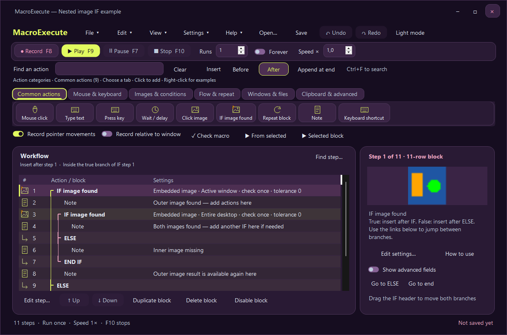

# MacroExecute

Version 1.12 adds configurable input timing, text-entry methods, repeatable randomization, image-tolerance interpretation, permission diagnostics and signing-aware exported players. The **`.mexec` workflow file type** remains compatible with existing workflows. See [file-format compatibility](docs/FILE-FORMAT.md). The project remains privately licensed pending a release/license decision.

A local Windows macro workbench with an original interface, source implementation and workflow format. Record a task, refine its steps, and replay it with visible control flow.

## Build and run

Requires Windows 10/11 and Microsoft .NET Framework 4.8. No .NET SDK, NuGet packages or third-party runtime dependencies are needed for the supplied build script.

```powershell
./build.ps1 -Test
./dist/MacroExecute.exe
```

For the extensive headless regression/stress suite, build first, then run `npm ci --ignore-scripts --no-audit --no-fund` and `npm test` on Windows. Playwright Test orchestrates the actual native engine and hidden Aftershock controls without launching browsers or sending desktop input. See [suite setup, coverage and limits](tests/playwright/README.md).

If the executable is already running, use `./build.ps1 -Test -Preview -OutputDirectory bin` to build and test a separate copy without closing your instance.

`build.ps1 -Preview` also renders light/dark previews using hidden controls, without showing windows or sending input. Outputs include `dist/MacroExecute-preview.png`, `dist/workbench-dark.png`, image editors and shortcut editors. The project can be opened with Visual Studio using MacroExecute.csproj. GitHub Actions builds and tests each push and provides an original executable as a private workflow artifact.

## Clean generated files

Run `./clean.ps1` to remove build outputs, temporary native test files and Playwright reports. Add `-KeepRelease` to retain the current animated build and `-Dependencies` to remove reinstallable npm packages. Source, examples, documentation and Git history are preserved. See [project structure](docs/PROJECT-STRUCTURE.md). Rebuild with `./build.ps1 -Clean -Test -Preview` for a clean, headlessly verified build. Only the current `MacroExecute.exe` is built; historical executable names are not needed. Test reports and previews are disposable and regenerated on demand.

## Use

Open **Help → Guides & examples**, press **F1**, or use **How to use** in the step inspector for a searchable visual reference. Right-click an action icon to learn about it before adding a step. Recipes cover first workflows, image matching, nested IFs, repeats and reusable files. Animated examples can be paused, replayed or inspected by clicking a numbered stage; Arrow keys step through stages and Space toggles playback when the illustration has focus. Examples never execute a macro or modify your workflow.

Open **Settings → Preferences** for appearance, recording options and playback defaults. **Open / Recent workflows** provides a searchable picker showing each workflow’s location and availability; **Browse files…** opens other workflows. Keyboard shortcuts can be searched without losing unsaved edits.

1. Press **F8** to record keyboard/mouse activity. MacroExecute minimizes; press **F8** or **F10** to stop. Injected events and MacroExecute's own UI are excluded. Mouse movement recording and window-relative coordinates are optional.
2. Search all actions with **Ctrl+F** (try image, loop, or hotkey), or choose an icon in the action tabs. Choose **Before / After** to insert around the selected row, or **Append at end** to add outside the current block. Double-click a row for guided settings. IF insertion creates IF / ELSE / END IF; Repeat adds END REPEAT. Move, duplicate, delete and enable operate on complete selected blocks, including nested blocks. Undo/Redo is available.
3. Press **F9** to play. A three-second countdown lets you focus your target. **F9** pauses/resumes and **F10** requests stop. These are the defaults; remap controls in Settings → Keyboard shortcuts. Playback will not start if your configured global Stop shortcut is unavailable.
4. Save as **`.mexec`**. External paths resolve relative to the workflow directory; bare program names can resolve through Windows. The mouse editor can pick a pointer position after a countdown. Image editors can capture or import a reference, show its preview, and test a search without clicking. References are embedded in the macro when saved. Recording uses the same Before / After insertion position; Pause/F9 pauses and resumes recording without recording the paused time.

Use **Settings → Workflow shortcuts** to assign up to nine saved workflows to Ctrl+Alt+1 through Ctrl+Alt+9 while MacroExecute is running. A binding opens the saved flow and starts the normal countdown. A running workflow must stop before another starts; unsaved changes prompt before replacement.

The welcome example activates an existing window whose title contains `Notepad`, then types three lines. Open Notepad first and review the example before playing. `safe-preview.mexec` only displays a message and sends no desktop input.

Use **Dark mode / Light mode** to change appearance, and **View → Accent style** for Neon, Aftershock, Crimson, Graphite, Ocean or Ember. Rounded cards, pill tabs, soft fields and toggle switches give the workbench a smoother appearance. **Settings → Keyboard shortcuts** remaps 22 MacroExecute actions, including global record/play/pause/stop and in-app editing commands. The compact **Common actions** tab provides the usual steps; **Show advanced fields** keeps extra properties out of the way until needed. See [interface and shortcut guide](docs/INTERFACE.md).

The refreshed workbench separates playback controls, action categories and the workflow into soft outlined surfaces. The empty workflow provides Capture / Refine / Run guidance; preferences show palette swatches with an explicit selected state. Guided step editors use consistent headings, and dark native scrollbars follow the active appearance where Windows supports them.

Category tabs visibly group their action icons. Colored nesting guides and bold block boundaries make nested IF/Repeat structures easier to follow. Drag rows to reorder actions, or drag a block header to move its entire nested block; a drop line and branch hint show the destination. Edge scrolling, Escape cancellation and Undo/Redo are supported.

The **Keyboard shortcut** tile builds combinations such as Ctrl+C as ordinary modifier-down / key-press / modifier-up steps in one undoable edit. Guided timing fields switch between seconds and milliseconds without losing precision. **Check macro** opens a readable report and can jump to the step needing attention; it checks structure, includes and the open workflow's reference images without running actions. Recent workflows appear on the empty workbench. New steps and recordings inherit disabled containing blocks, and empty recordings leave history unchanged.

Use **Find step…** above the timeline (Ctrl+Shift+F) to search existing steps, with F3 / Shift+F3 or Enter / Shift+Enter to move between results. This keeps all rows visible and preserves drag destinations. Image summaries expose inverted conditions, wait limits and search area; selected blocks show their full edit scope. Play/Pause/Resume and Finish recording labels follow the current state. Undo back to the saved document clears its change marker.

The empty workbench offers starter buttons. Branch navigation links jump to ELSE, matching block ends, and parent blocks. A persistent footer shows the run count, speed, Stop key, and save state; step validation errors appear inline. Higher-contrast text, outlined fields and stronger selection/focus cues improve readability in both palettes.



Use **Windows & files → Run program / file** to launch an application or open a document. Its settings include a file-type dropdown, Browse, and optional arguments. See [file groups and script examples](docs/LAUNCH-FILES.md).

## Copy and check item text

Use **Clear clipboard → Mouse move → short Delay → Copy to clipboard (Ctrl+C) → IF clipboard matches**. Conditions support any string, all strings, or alternative AND groups. Put actions inside IF and leave ELSE empty to skip unmatched items. The copy action can wait for fresh text so failed copying cannot silently reuse an old item. See the [worked item-data examples and settings](docs/CLIPBOARD-WORKFLOWS.md).

## Supported actions

| Category | Actions |
|---|---|
| Input | KeyDown, KeyUp, KeyPress; MouseMove, MouseDown, MouseUp, MouseClick, MouseWheel; TypeText, TypeDate, TypeEnvironment |
| Flow | Note, Delay, Repeat/EndRepeat, Break, Label/Jump, Include, Pause |
| Conditions | IfPixel, IfImage, IfClipboard, IfWindow, IfFile, IfProcess; Else/EndIf |
| Desktop | ActivateWindow, MoveWindow, WaitWindow, WaitProcess, FindPixel, WaitPixel, FindImage, WaitImage, ClickImage |
| Integration | CopySelection (Ctrl+C), SetClipboard, ClipboardClear, ClipboardIncrement, Paste, Launch, OpenUrl, Message, CopyFile, DeleteFile, RunCSharp |

Field details:

- **Text** holds typed text, label/window-title fragment, launch arguments, clipboard value or copy destination according to the action. **Target** holds program/image/macro/source path, URL or environment-variable name. TypeDate uses Text as a .NET date format, default `yyyy-MM-dd`.
- **KeyCode** is a Windows virtual-key integer (65=A, 13=Enter); Extended represents the extended-key flag. Mouse wheel delta is normally ±120. Coordinates are physical virtual-desktop coordinates; optional Relative uses the current foreground window's top-left.
- Pixel/image search can use the entire desktop, foreground window, or a rectangle. Old documents retain their rectangle-or-desktop behavior. ColorRgb is `#RRGGBB`. Tolerance is the inclusive RGB channel difference, 0–255; zero is exact. Fully transparent template pixels are ignored; an entirely transparent image is rejected. No scaling/rotation/OCR is performed.
- **Click image** finds and clicks its center atomically. **Wait image** polls until found. Find/Click/Wait can stop on a miss or explicitly skip and continue; invalid files remain errors. Timeout 0 checks once, while Wait forever remains cancellable. Pause suspends polling and prevents a found image from being clicked while paused.
- **IF image found** supports arbitrary same-file nesting, ELSE branches, optional waiting and inversion. Each IF has a scoped image result. An inner failed search clears its own result, so its ELSE cannot accidentally click the outer image. After its END IF, the outer result is restored. Use Mouse click → Last image / pixel match inside a successful branch, or Current pointer to avoid repositioning. Last-match coordinates support offsets.
- Use **Selected block** to play one action or complete block, or **From selected** for the remaining steps. Incomplete block selections are rejected before playback.
- Repeat count 0 repeats until Stop or Break; the toolbar Forever option repeats the whole macro until Stop. Optional maximum delay/repeat values and coordinate jitter enable bounded randomization. Labels are case-sensitive and unique within their include scope. Includes have cycle/depth limits. Jump cannot enter an inactive Repeat or IF block. Speed applies to Delay steps; Runs repeats the entire validated workflow.
- Message waits for acknowledgement. Pause waits for F9/resume. Launch passes Text as native Windows command-line arguments; it does not interpret a shell script. CopyFile refuses overwrite. DeleteFile removes the specified file, so review imported flows before execution.
- IfFile uses Target; IfProcess/WaitProcess use Text as the process name (with or without `.exe`). ClipboardIncrement uses DelayMs as the nonnegative increment amount. Paste sends Ctrl+V without changing clipboard contents. SetClipboard with empty Text clears it.

**RunCSharp** compiles Text as a complete C# console program with its own static Main entry point, then runs it in a separate process. System, System.Core, System.Drawing and System.Windows.Forms references are added explicitly. TimeoutMs bounds the running child; cancellation terminates that child. Compilation itself is not preempted, and child-spawned descendants are not tracked. This is process separation, **not a security sandbox**: scripts have your user permissions and must be trusted. Compiler diagnostics are shown with line numbers. No script is run merely by opening a workflow.

For a safe nesting example, open `examples/nested-image-if.mexec`: it contains two image IF blocks and explanatory notes, with no clicks. Replace each reference through its guided editor. See [image workflows](docs/IMAGE-WORKFLOWS.md) for examples.

## Export and schedule

**Export player** embeds a flattened workflow into a copy of MacroExecute's own executable, with a SHA-256 checksum. Opening the exported executable displays its workflow for review; press Play to run. Image references are embedded for both UI and command-line export. Other external files and .NET Framework 4.8 remain prerequisites. There is no third-party template or binary rewriting library.

**Schedule** saves the workflow, then offers a future date/time and optional daily repetition. A confirmed schedule creates a uniquely named interactive-user, least-privilege Windows task. The user must be logged in with an unlocked desktop for input automation. Manage/remove schedules in Windows Task Scheduler. Scheduled playback uses `--run` and `--exit`.

```powershell
./dist/MacroExecute.exe ./examples/welcome.mexec
./dist/MacroExecute.exe --validate ./examples/welcome.mexec
./dist/MacroExecute.exe --export ./examples/safe-preview.mexec "./dist/Safe preview.exe"
./dist/MacroExecute.exe --verify-player "./dist/Safe preview.exe"
./dist/MacroExecute.exe --run "C:\Flows\My flow.mexec" --exit
./dist/MacroExecute.exe --self-test ./dist/test-results.txt
```

## Validation and limits

The automated suite covers Unicode/newlines, schema rejection, atomic persistence, IF/repeat nesting, labels, include cycles/scopes, pause/cancellation cleanup, odd-width pixels, right-edge image matching, tolerance, native structure sizes, portable corruption/re-export and Windows argument quoting. UI smoke rendering was also checked locally. These tests do not install hooks, inject real desktop input, modify the clipboard, create tasks or access the network. A guarded real-desktop acceptance test also passed five clicks on a moving target, including nested image IF/ELSE and atomic ClickImage. It used tolerance 50 because the desktop pointer highlight changed captured colors. Other applications, recording hooks, privilege/DPI combinations and Task Scheduler still need acceptance on the intended target desktop.

This is a functional reimplementation, not exact feature/file compatibility. Proprietary macro import, license activation, dedicated VPN/shutdown commands and automatic updates are not implemented. Use Launch for separately authored external tools or Windows utilities where needed. Unicode injection support depends on the target app; Windows integrity rules can block input to elevated windows. No global input blocking is used. A ten-million-step execution budget bounds finite-mode accidental loops; intentional Forever playback and Repeat count 0 bypass that budget while yielding for pause/stop. Include limits still apply. Image matching is a cancellable straightforward raster search, without OCR/scaling/rotation.

## Architecture and rights

See [architecture](docs/ARCHITECTURE.md) for implementation details and [LICENSE](LICENSE) for the current rights notice. Public source availability does not itself grant a license to use or redistribute the application.

Public platform references: Microsoft's [SetWindowsHookEx documentation](https://learn.microsoft.com/en-us/windows/win32/api/winuser/nf-winuser-setwindowshookexw), [SendInput documentation](https://learn.microsoft.com/en-us/windows/win32/api/winuser/nf-winuser-sendinput), and [Task Scheduler scripting objects](https://learn.microsoft.com/en-us/windows/win32/taskschd/task-scheduler-scripting-objects).

Crimson is available in **Settings → Preferences** and **View → Accent style**, in light and dark mode. All six palettes share the same controls, spacing and rendering; headless checks cover compact dialogs and readable text contrast for every palette.

## Playback compatibility and Windows permissions

Step editors expose **Button / key hold**, text-entry method and character pacing. Unicode is the default; clipboard paste is opt in and restores a materialized snapshot only if the clipboard sequence is available and unchanged. CRLF, CR and LF each map to Enter; tabs map to Tab. Use a longer hold or paste settle time for slower target applications. Playback speed scales Delay actions; key holds, text pacing and search timeouts remain real milliseconds.

Image actions default to exact inclusive per-channel RGB tolerance. **Legacy RGB threshold + 1** increases the configured per-channel threshold by one, capped at 255. This setting does not imply compatibility with third-party capture, matching or file formats.

**Settings → Workflow randomization** optionally stores a fixed seed in the workflow. It reproduces repeat counts, delays and pointer jitter for the same workflow and execution path. A changing screen, external process or branch result can still change the execution path. Includes use the root workflow seed.

**Settings → Permissions / administrator** shows the current permission mode and offers a user-confirmed UAC restart. It saves the workflow first and reopens it without automatically playing. Known higher-integrity targets fail with a specific message. Protected/unknown tokens still rely on Windows input rejection. The default remains standard-user execution; no UIAccess or UAC security policy is changed.

Exported players recognize PE certificate tables and alignment padding. Exporting creates a new unsigned artifact, including when the source app is signed. Sign the final executable separately with your own trusted code-signing certificate using `sign-release.ps1`; see [behavior, permissions and signing](docs/COMPATIBILITY.md).

Modified and multiple mouse clicks: [Alt/Ctrl/Shift clicks, double/triple clicks and long presses](docs/MOUSE-CLICKS.md).

Clipboard conditions now support [expandable string rows](docs/CLIPBOARD-WORKFLOWS.md): quoted phrases, space-separated OR alternatives, distinct matches for AND rows and alternative groups.

The refreshed [design and configuration guide](docs/DESIGN.md) covers theme previews, guided action settings and the simplified clipboard rule builder.
