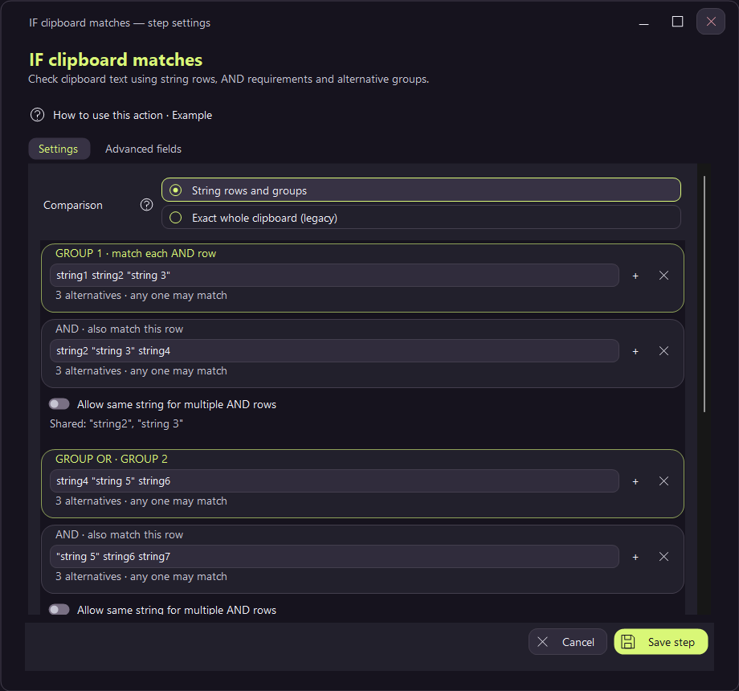
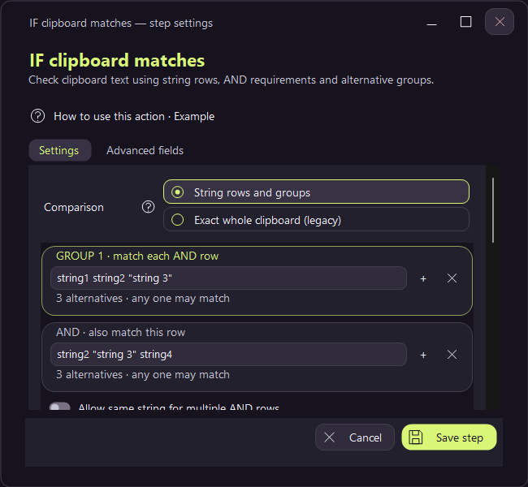
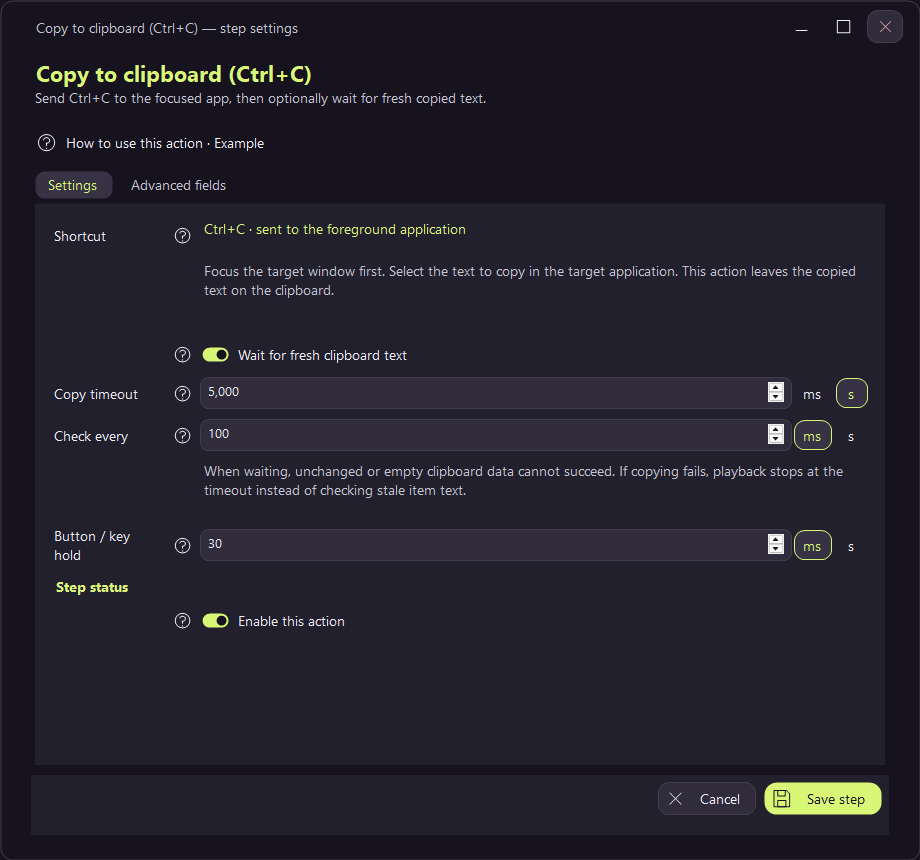
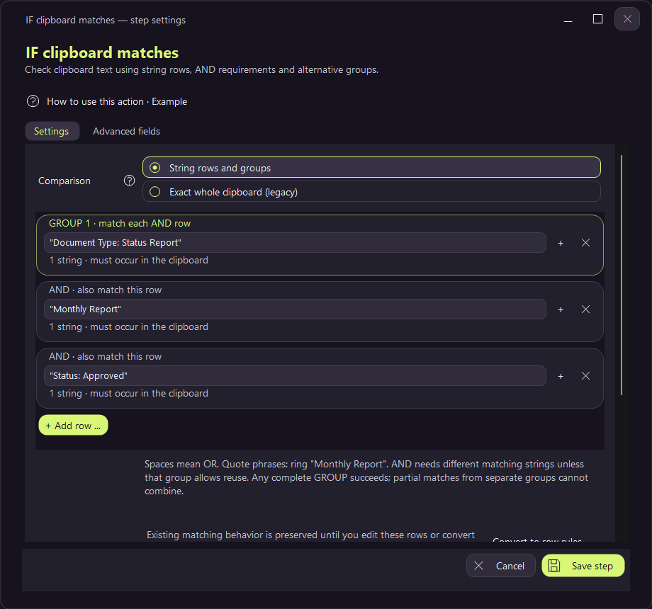

# Copy item data and choose actions by clipboard strings

Use **Clear clipboard → Mouse move → short Delay → Copy to clipboard (Ctrl+C) → IF clipboard matches** to inspect selected text. Copy sends Ctrl+C to the foreground app and waits for fresh, non-empty clipboard text. Paste sends Ctrl+V and is a different action. Open [the item example](../examples/clipboard-item-check.mexec) and select the sample text before running.

## Expandable string rows

New clipboard conditions open with one empty row. Type alternatives separated by spaces. Surround a phrase with double quotes to keep it as one string:

```text
string1 string2 "string 3"
```

That row can match `string1`, `string2`, or the complete phrase `string 3`. You can mix quoted and unquoted strings. Matching uses literal substrings, without regex or wildcards.

Click **+** beside a row, or **+ Add row**, to insert after it:

- **Required string row · AND**: another requirement within the current group.
- **Alternative group · GROUP OR**: an independent group; any complete group can succeed.

Add more OR alternatives with spaces in the same row; the redundant + OR command has been removed. Older saved OR rows open as merged space-separated alternatives with the same meaning.

Use **×** to remove an unused row. Every added row must contain a string before saving. Each row shows its relationship and number of alternatives; unmatched quotes display a hint.

**By default, each AND requirement must match a different string.** The same matched string cannot satisfy multiple required rows within a group. Repeated spellings, including case variants when Ignore case is enabled, count as one string. This checks distinct criterion strings, not separate clipboard occurrences; different strings can overlap in the clipboard text.

## Your example

The labels between these input rows are chosen with the + menu:

```text
string1 string2 "string 3"
AND
string2 "string 3" string4
GROUP OR
string4 "string 5" string6
AND
"string 5" string6 string7
```

| Clipboard contains | Result |
|---|---|
| `string1` and `string2` | Match: two different strings satisfy group 1 |
| `string2` alone | No match: it cannot satisfy both AND requirements |
| `string4` and `string 5` | Match: two different strings satisfy group 2 |
| `string1` and `string 5` | No match: partial groups cannot combine |

Open [the saved row example](../examples/clipboard-row-groups.mexec). Its IF/ELSE branches contain placeholder messages; replace them with your actions, or leave a branch empty to skip it. Nested clipboard IFs remain supported.



## Item-data example

Enter `"Monthly Report"` in the first row, then add an AND row containing `"Status: Approved"`. To accept a second combination, add a GROUP OR row containing `"Monthly Report"`, then an AND row containing `"(Priority: 1)" "(Priority: 2)"`. This accepts approved reports or either priority alongside the report title.

Expand **Try with sample text**, load the included item text, and press **Test condition**. It reports IF or ELSE without reading/writing the system clipboard or executing macro actions.

Ignore letter case remains optional. NOT reverses a valid comparison; an empty or non-text clipboard never matches, even with NOT. Exact whole clipboard compares the complete text, including line breaks. Up to 128 alternative strings are supported per condition. Use `\"` for a literal quote and `\\` for a literal backslash inside quoted strings. Quote standalone words `AND`, `OR` or `GROUP OR` when using them as literal input.

## Existing workflows

Exact, Any, All and Groups workflows retain their original behavior. The editor quotes old multiword strings automatically for display. Merely opening and saving an existing condition preserves its original mode and contents. Editing the rows or clicking **Convert to row rules** opts into the new distinct-string behavior. Existing old modes remain available in Advanced fields.

The rule builder uses comparison mode 4 and existing action ID 24. Source, saved workflows, cloned steps, included workflows and exported players preserve the expression. Older binaries cannot run mode 4 and must be updated. Copy remains action ID 47; other action IDs are unchanged.

Headless verification uses synthetic clipboard/keyboard adapters and hidden rendering in Aftershock plus all other palettes. It does not operate a game or send desktop input.







## Allow the same string in multiple AND rows

When separate AND requirements in a group share an alternative, the editor shows **Allow same string for multiple AND rows** beneath that group, together with the repeated strings. `word` and `"word"` are the same string. Ignore letter case also governs overlap detection. Repeated alternatives within a single OR requirement do not show this option.

The checkbox defaults to off. With `word AND "word"`, off requires different strings and therefore cannot match; on lets a single `word` satisfy both requirements. Every other required row must still match. The choice belongs to that group alone and cannot combine partial matches from different groups. Editing out the overlap removes the option and its saved permission.

The checkbox refreshes as you type, add/remove rows, or change Ignore letter case. Saved workflows, cloned steps and exported players preserve each group's choice. Existing workflows without this setting retain their previous distinct-string behavior. Older application builds ignore the new reuse setting; use the updated app/player to reproduce it.
