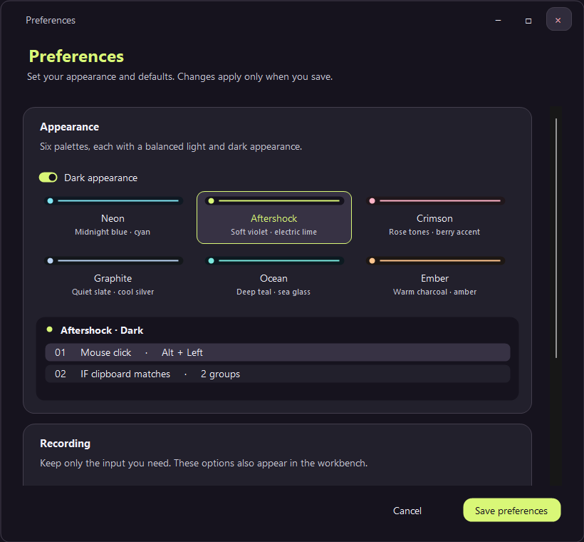
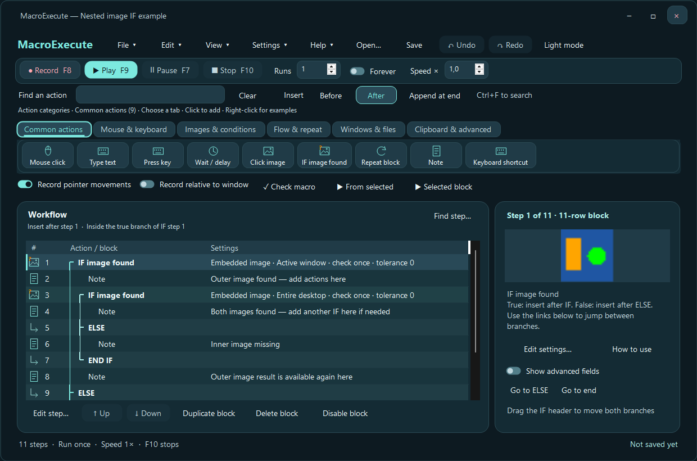
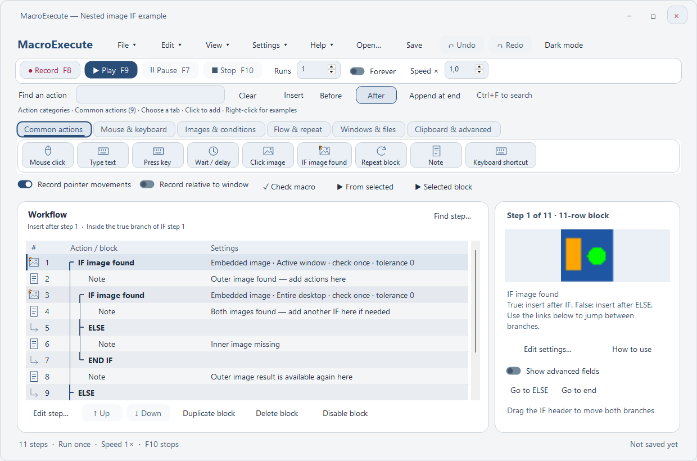
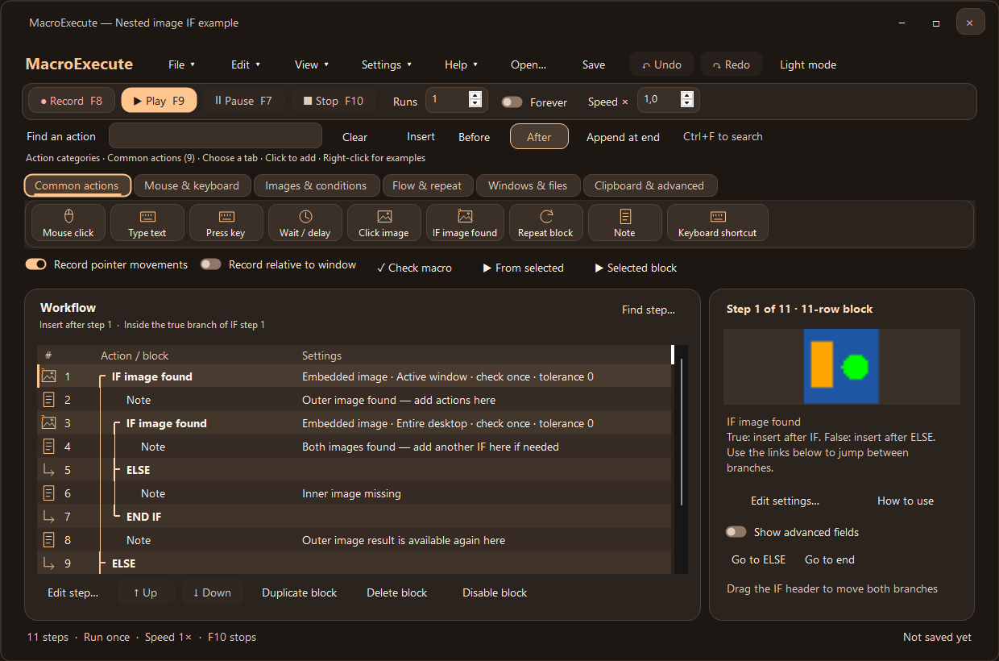

# Design and configuration refresh

The interface uses one set of rounded controls, field spacing, selection states and typography across the workbench and dialogs. Action icons remain compact. Existing animated setup/outcome examples, keyboard shortcuts and nesting guide lines remain available.

## Appearance

Open **Settings → Preferences** to select a palette and light/dark appearance. The gallery shows all six palettes and an isolated preview of the selected combination. Preferences apply only when saved. **View → Accent style** also changes the workbench palette.

| Palette | Character |
|---|---|
| Neon | Midnight blue and cyan |
| Aftershock | Soft violet and electric lime |
| Crimson | Rose and berry |
| Graphite | Slate and cool silver |
| Ocean | Teal and sea glass |
| Ember | Warm charcoal and amber |

All twelve combinations use the same layouts. Body, secondary, accent and primary-button text have automated 4.5:1 contrast checks. Theme selection and previews do not change the workflow.

## Configuration screens

Selected radio choices are outlined cards, with consistent indicators and keyboard focus. Related fields have section headings: click behavior, pointer location, image reference/search region, match accuracy, waiting/result and timing. Current-pointer clicks disable unused coordinate fields. Double/triple-click timing remains enabled only when needed.

Repeat has an explicit **Repeat until stopped or Break** switch, with finite count and optional random upper limit. Copy file, Move window, pixel checks and clipboard increments have guided fields. Actions without parameters explain their behavior. Advanced properties remain available, and every action keeps its setup/outcome guide in the same place.

## Clipboard groups

Spaces already mean OR, so the + menu now contains only **AND** and **GROUP OR**. Existing OR rows merge into alternatives in the same input without changing their matching meaning. Quoted phrases remain intact. Rounded rule cards, highlighted group starts and spacing distinguish separate groups. The per-group shared-string switch remains conditional on actual overlap between AND requirements.

The editor stays scrollable at its minimum size; Save and Cancel remain outside the scrolling content. Testing renders hidden controls in all palettes and at compact sizes, without opening windows or sending input.

## Editing and sharing the application window

Undo and Redo use stronger accent treatments; their disabled states indicate that no history is available. The toolbar color-mode control is a sun/moon icon with a tooltip and accessible name. Open lives under File (Ctrl+O).

Select a range with Shift-click or separate rows with Ctrl-click. Ctrl+A selects all rows; Ctrl+C copies, Ctrl+X cuts, and Ctrl+V inserts at the Before/After marker. These shortcuts belong to the sequence list; text fields retain normal text editing. Copying an IF or Repeat header includes its complete block. Invalid partial control flow or missing jump labels are rejected without editing the document. Paste remaps colliding internal labels, and Undo reverses the entire insertion. Use cut/paste to move multiple separate sections together.

**File → Save selection as workflow…** (also in the sequence context menu) creates a `.mexec` file without changing the open document. Embedded images remain embedded, and external paths remain anchored to the original workflow directory. Includes remain external dependencies.

Navigation menus, guided action editors, preferences, shortcuts, guides, review panels and app confirmations render as child controls in the main application window. Background editing is disabled while an editor is open; Save/Cancel returns to the workflow. This avoids separate top-level application windows during window-only sharing. Native file pickers, Windows permission prompts and screen-selection overlays remain separate OS surfaces. Actual Discord capture behavior requires live acceptance testing; automated checks stay headless.

## Recognizable icons

Every action has original vector artwork, shared by the action library, sequence rows and inspector. Object silhouettes identify images, pixels, keys, mouse operations, windows, files and clipboard actions. A consistent badge indicates IF (diamond), waiting (clock), finding (magnifier), clicking (pointer), or key/button press and release (down/up arrows). Clipboard copy, paste, clearing and incrementing have distinct marks; control-flow boundaries use branch/merge and loop symbols.

Toolbar, navigation, settings, editor and window-control buttons use the same stroke style. Text labels, tooltips and accessible names remain available. Icons follow the active theme and button contrast. Headless previews include light/dark Aftershock reference sheets; checks cover distinct, nonempty action icons at 16, 22 and 32 pixels in every palette and stable button sizing.

The executable and application windows use an original play/loop mark with 16–256 px icon frames. Rebuild `assets/MacroExecute.ico` with `./tools/generate-app-icon.ps1`; both build paths embed the same artwork. No downloaded icon pack or third-party image asset is required.
