# Interface guide

MacroExecute uses an action library, a workflow timeline and a step inspector. Examples are original illustrations of sample settings. They never click, type, launch programs or modify your workflow.

## Build a workflow

Record a short task, or choose an action icon. The category tabs change the visible actions. Search looks across categories; Enter opens the first result and Escape clears the search. Hover an icon for its purpose, or right-click it for a visual guide before adding it.

Select a timeline row and choose **Before** or **After** to set the insertion point. **Append at end** leaves the current block. The hint above the timeline names the current branch. Double-click a row to edit its settings.

Drag an ordinary row to reorder it. Drag an IF or Repeat header to move the complete block, including nested blocks. ELSE and END rows travel with their opening header. Colored lines show nesting. The inspector provides **Go to ELSE**, **Go to end** and **Parent block** navigation. Delete, duplicate and enable/disable labels distinguish an entire block from an individual step. Undo restores these edits.

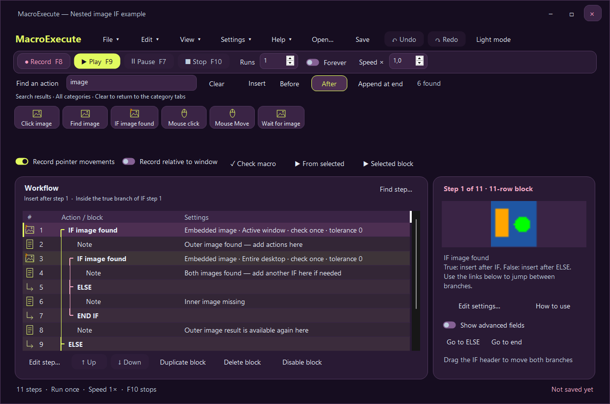

Use **Find step** to search long workflows. **From selected** runs a balanced remainder; **Selected block** tries a complete action or block. Check macro validates structure and references before playback. Start with one run; use Runs or Forever after validating the workflow. The current Stop shortcut appears in the toolbar and status bar.

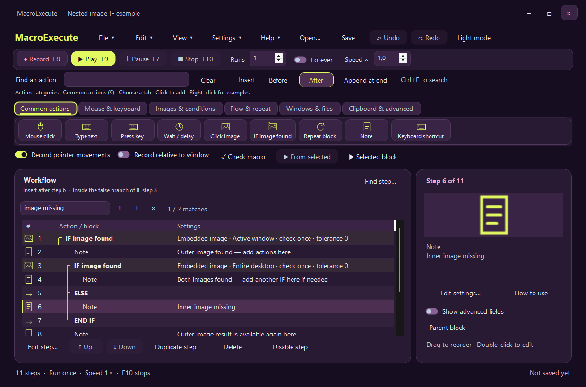

## Learn an action

Open **Help → Guides & examples**, use **How to use** in the inspector, or right-click an action icon. F1 opens help when it has not been assigned to another application command. Ctrl+F focuses guide search. Search includes action names, field explanations, sample values and recipe text. Clear restores the full list; a matching current topic stays selected while filtering.

Recipes cover first workflows, image matching, nested decisions, repetitions, included files and troubleshooting. Related-guide buttons explain useful companion actions without inserting them into the workflow. ELSE and END boundaries have reference entries too.

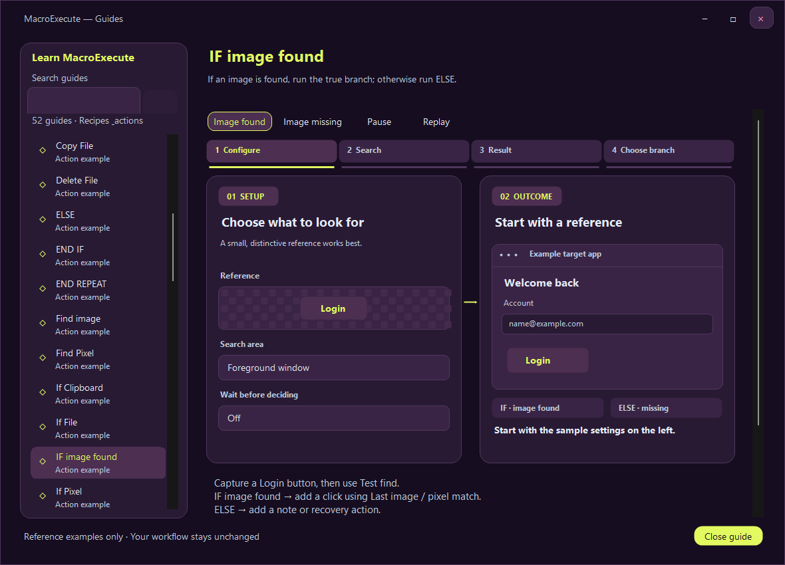

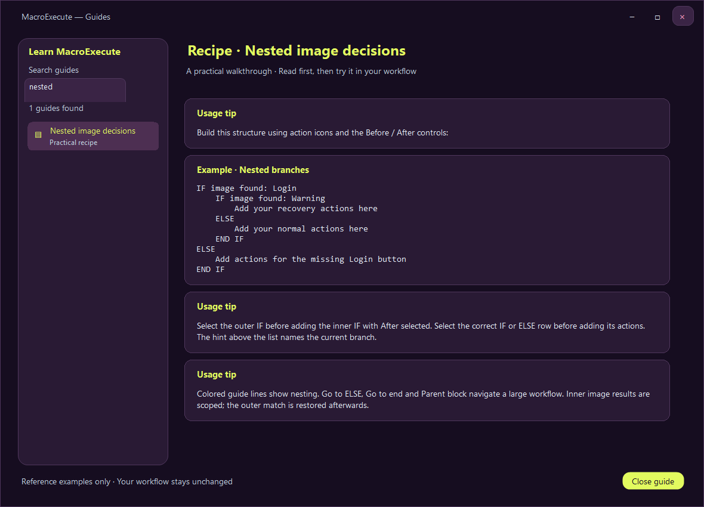

Every step editor has **How to use this action** in the same location below its heading, with field-specific **?** hints. The guide takes over the editor viewport; **Back to settings** returns to the unchanged draft. Escape returns from an editor guide before cancelling the dialog. Advanced fields remain available for less common properties.

## Animated examples

IF image found, Click image, Repeat and Run program / file include animated walkthroughs. Other action examples use static illustrations. The runtime draws animations directly; no GIF files or external animation library are required by the executable.

Pause holds the example, Replay restarts it, and clicking a numbered stage pauses there. When the illustration has keyboard focus, Left/Right inspect stages and Space toggles playback. Scenario changes restart the animation and reset the playback label. Animations stop when their guide is hidden or its window is minimized. Headless rendering never starts an animation timer.

| Example | Walkthrough |
| --- | --- |
| Image found | 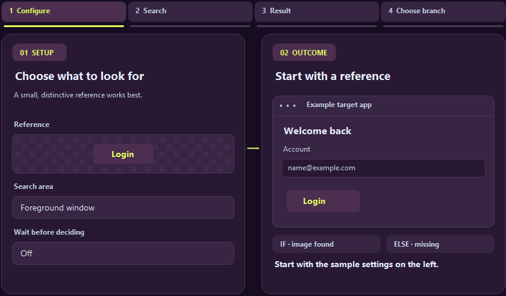 |
| Image missing | 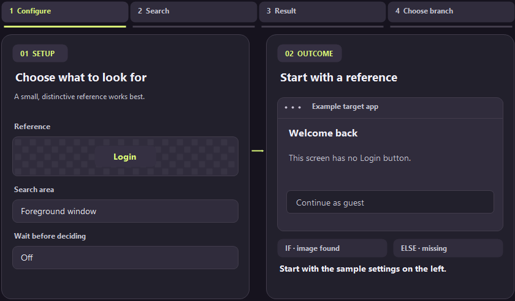 |
| Find and click | 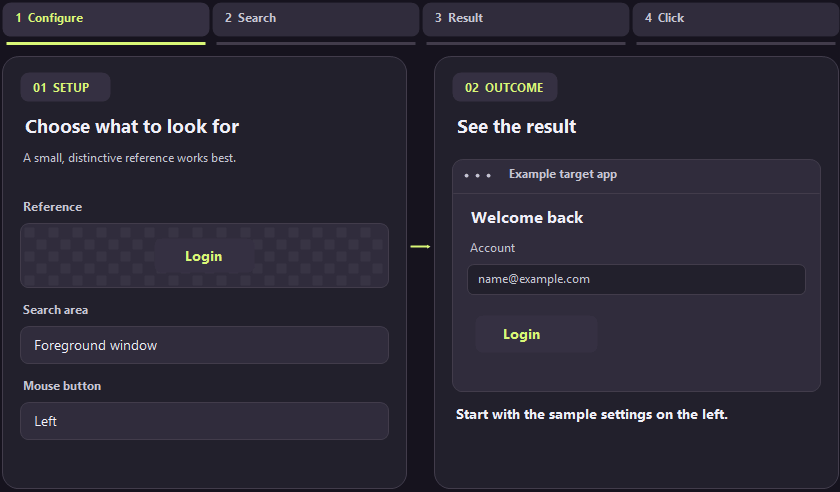 |
| Repeat a block | 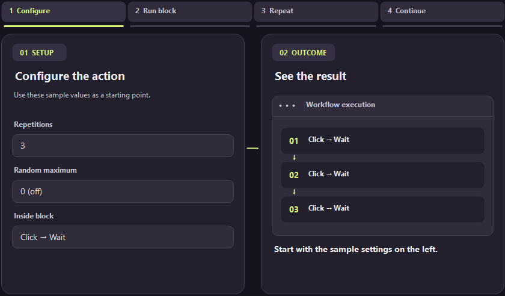 |
| Run a program or file | 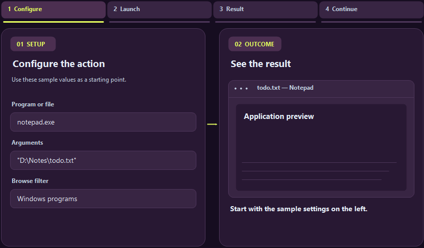 |

## Images and launching files

Capture a small, distinctive reference and match its display scale. Use **Test find** before playback. Image search can cover the desktop, a window or a mouse-selected rectangle. Click image searches and clicks automatically; IF image found only chooses a branch. Add a click using the last match when needed. Nested IF results are scoped and the outer match is restored afterwards. See [image workflows](IMAGE-WORKFLOWS.md).

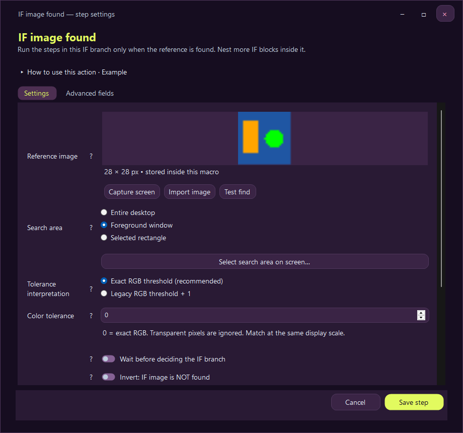

Run program / file puts the target and Browse first, followed by an optional file-type filter. Extra options reveal arguments without requiring them for a simple document. See [launch settings and file types](LAUNCH-FILES.md).

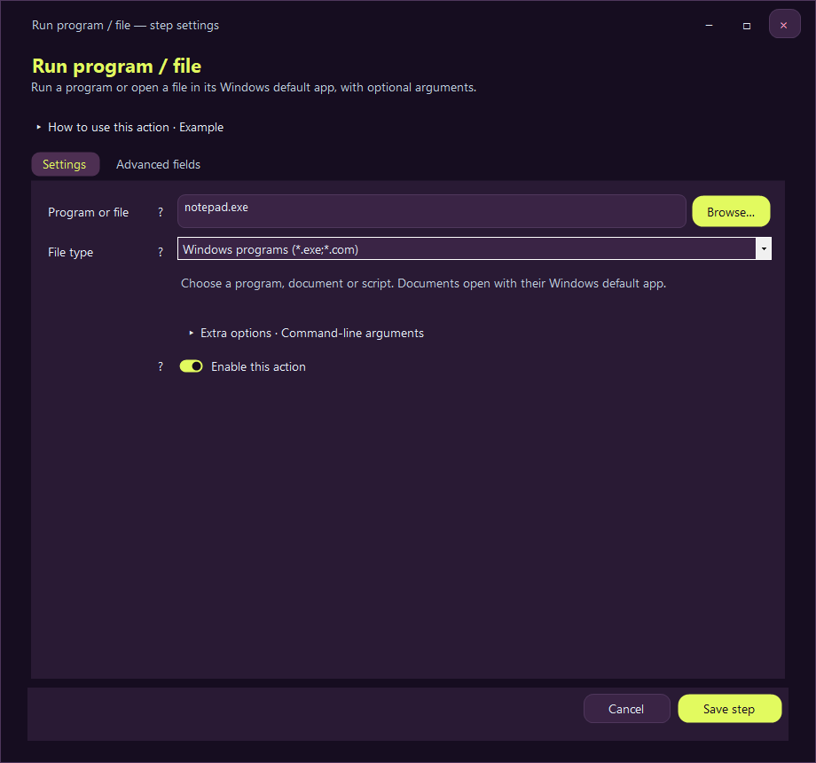

## Appearance and keyboard settings

Settings → Preferences controls light/dark mode, Neon/Aftershock/Crimson/Graphite/Ocean/Ember palettes, recording options and playback defaults. All twelve light/dark combinations share contrast checks and compact-layout coverage. Selecting a palette does not modify workflow steps.

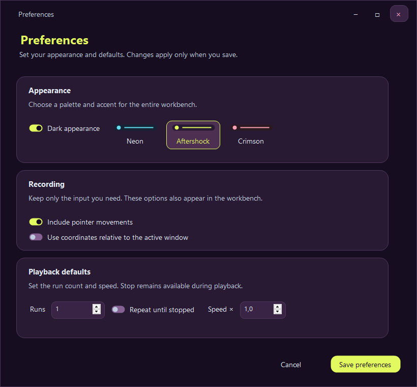

Settings → Keyboard shortcuts remaps recording, playback, pause, stop, editing, navigation and theme actions. Search the command list, select a command and capture a combination. Conflicts are validated before saving; cancelling preserves existing assignments. The toolbar shows configured playback keys. Playback requires an available global Stop shortcut.

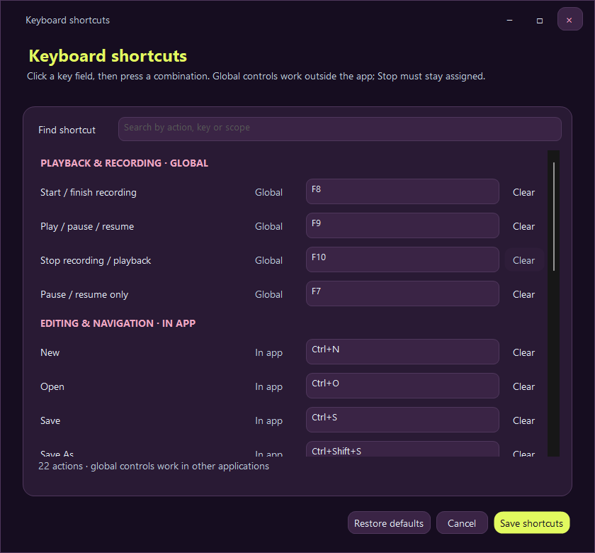

Workflow shortcuts separately associate saved files with Ctrl+Alt+1 through Ctrl+Alt+9. Recent workflows show both file location and availability; opening a file does not run it.

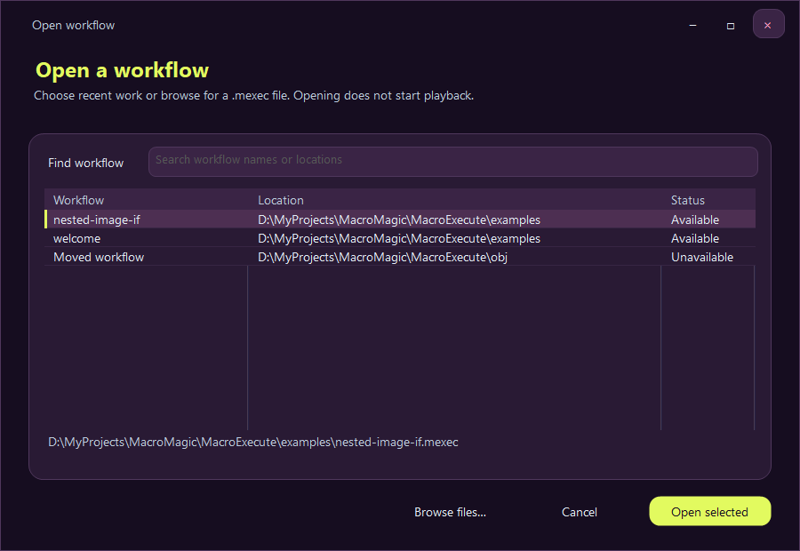

## Maintain the previews

`./build.ps1 -Test -Preview` compiles, runs native checks and renders hidden controls. Normal previews omit raw animation frames. Add `-GuideFrames` only when regenerating the five GIFs. Then run `python tools/export-guide-gifs.py dist/animation-frames docs` with Pillow installed. The exporter verifies every decoded frame and the 9.6-second duration. `docs/animation-validation.json` is disposable and ignored; GIFs are documentation assets.

Tests use Aftershock by default, isolated preferences, synthetic input hosts and hidden rendering. They do not show application windows, register global shortcuts, capture the screen, move the pointer or inject keyboard input. See [testing](TESTING.md).
