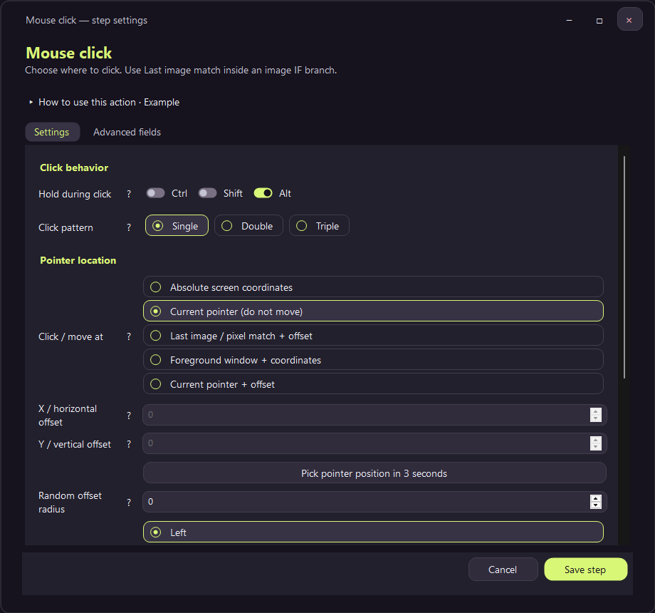

# Modified mouse clicks

In **Mouse click** or **Click image**, select Ctrl, Shift or Alt under **Hold during click**. Combine switches when needed. For Alt-click, enable Alt and leave the pattern at Single. This replaces Key Down Alt → click → Key Up Alt.

Choose Single, Double or Triple. Left, right and middle buttons all support these options. Button / key hold controls each press; Between clicks controls the gap. The Normal press preset uses 30 ms. Long press selects Single and a 750 ms hold; adjust the duration for your target application.

Image clicks find the image first, then acquire modifiers and click. Missing images do not press modifiers. For a modifier that must remain down during image search or dragging, use explicit Key Down / Key Up steps.

Modifiers remain held throughout double/triple clicks and release in reverse order. Keys already held by the macro or user remain held. Cancellation and failures attempt to release acquired buttons and modifiers; playback cleanup retries tracked releases. Application-specific responses to modified clicks and double-click timing still depend on the target application.

Old workflows retain a single click with no modifiers. New settings survive workflow saves, clones and exported players. Older binaries ignore these new fields, so use the updated application to run modified clicks.
